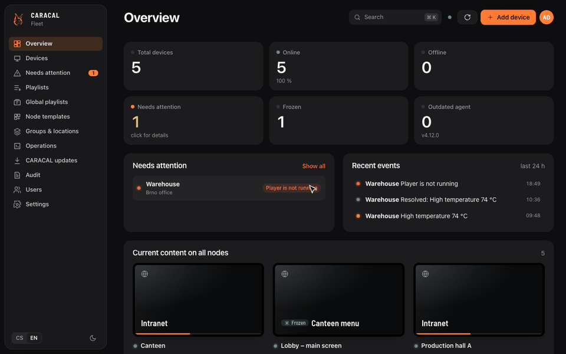

<p align="center">
  <picture>
    <source media="(prefers-color-scheme: dark)" srcset="docs/brand/hero-dark.svg">
    
  </picture>
</p>

<p align="center">
  Central management for <a href="https://github.com/Gelluithor/Caracal">CARACAL</a> digital signage screens:
  monitoring, content, schedules and installation of every screen, self-hosted with one <code>docker compose up</code>.
</p>

<p align="center">
  <a href="https://github.com/Gelluithor/Caracal-Fleet/releases/latest"></a>
  <a href="https://github.com/users/Gelluithor/packages/container/package/caracal-fleet"></a>
  
  <a href="LICENSE"></a>
</p>

<p align="center">
  <a href="#quick-start">Quick start</a> ·
  <a href="#adding-screens">Adding screens</a> ·
  <a href="#permissions-and-roles">Permissions</a> ·
  <a href="#security">Security</a> ·
  <a href="https://github.com/Gelluithor/Caracal">CARACAL node</a>
</p>

<p align="center">
  
</p>

---

## How it fits together

```
 browser ──HTTPS──▶ CARACAL Fleet (FastAPI + web UI, SQLite)  ──▶ alerts: e-mail, Teams, Slack, Telegram, ntfy…
                         ▲     │ backups ──▶ S3, WebDAV, SFTP, SMB, NFS, rclone
                         │     │
     heartbeats, plays,  │     │ commands (long polling), files, CARACAL images
     screenshots         │     ▼
                  ┌─ Fleet Agent ──local Fleet API──▶ CARACAL node: web admin, Chromium player, overlay
  every screen ───┤                                     (Raspberry Pi or PC, Docker or classic)
                  └─ (optional) all downloads through Fleet for nodes without internet access
```

The agent on each screen opens every connection itself, so the screens can sit behind NAT or in another network;
only the SSH console and the installation over SSH connect to a node. Logins of websites and watchers travel only to
the node, and camera passwords are never shown and leave the command history once delivered.

## Features

### Watch every screen

- **Monitoring:** online state, CPU, RAM, disk, temperature and what each screen is playing right now, plus
  a *Needs attention* list with the reason for each issue; metric graphs and availability for 24 hours or 7 days and a
  timeline of outages, problems and commands per device
- **Alerts for administrators:** when a screen goes down or has a problem, a message by e-mail (SMTP), Microsoft
  Teams, Slack, Discord, Telegram, ntfy or a webhook, after a delay you choose, grouped into one message per check,
  with a "resolved" message too; devices can be muted for maintenance. The same channels hear about a new version of
  Fleet and the result of its update
- **Screen wall:** what every screen shows right now, refreshed while the page is open
- **Map:** every location on a map (OpenStreetMap) with the state of its screens; coordinates are found from the
  address in one click
- **Monthly reports:** a PDF with availability, outages, problems and the most shown content of a month, downloaded
  or e-mailed automatically on the 1st
- **Content warnings:** an alert when items run out of their validity in the next days, and a problem on a screen
  whose playlist is empty or has nothing valid left
- **Proof of play:** what every screen showed and for how long, by content, screen or day, with a chart and a CSV
  export (CARACAL 2026.10.23.1 with agent 4.17)
- **Display watch:** the agent restarts an X display that stopped answering, the node restarts a player whose website
  stays black; both show up as problems and alerts
- **Diagnostics and reinstallation:** a report of a node whose screen stays black (disk, memory, power, display
  outputs, the X server, containers and system log, with the usual causes pointed out), and *Reinstall CARACAL*
  from scratch – optionally as a factory reset with a new administrator and a template
- **SSH console:** a terminal on any node right in the browser (the hub connects over SSH, nothing to install)

### Put content on them

- **Content:** playlists with web pages, images, videos and Grafana collections; logins for web pages that need
  a username and password, as a log-in form or the browser's HTTP log-in pop-up (stored encrypted on the node only);
  show or freeze an item, skip, resume, restart the player or the device
- **Widgets:** a clock, the weather (Open-Meteo), news from RSS / Atom, a table from CSV or Google Sheets and a text
  as playlist items, with a live preview; the node draws them itself (CARACAL 2026.10.23.1 with agent 4.17); also a
  calendar and a meeting room (free / busy) from an ICS link of Microsoft 365, Outlook or Google, a QR code and a
  ticker of your own text or RSS
- **Screen layout:** a side panel and a bar at the bottom next to the playlist, each with its own widget
  (CARACAL 2026.10.25)
- **PDF and presentations:** a PDF, PowerPoint, Impress or Word document becomes one picture per page in the media
  library and in the playlist
- **Offline fallback:** when a website cannot be loaded, the node shows a calm placeholder and goes on with the next
  item instead of a browser error
- **Cameras:** RTSP and HTTP streams of IP cameras and recorders as playlist items, up to 9 in a grid; ONVIF cameras
  and recorders (NVR, every channel) are found in the node's network and asked for their streams, with a picture of
  each stream before it goes on the screen; their passwords stay on the node, encrypted. Cameras can also be part of
  a global playlist (agent 4.17 and newer): Fleet then keeps their passwords to hand them to the nodes, never shows
  them and removes them from the command history once delivered
- **Content with a validity:** any item (also in global playlists) can play only from / until a time – a weekend
  offer goes on and off the screens by itself
- **Websites in dark mode:** per node or per website and Grafana collection – the sites' own dark look or forced
  dark for every page
- **On-screen notifications:** send a notification to one screen or many, change the notification settings (position,
  size, sound, limits, your own MP3 per level) and their look in a visual editor with a live preview of the TV (colours,
  icons, shape, banner, font, animation) and manage watchers that announce new tickets or issues from other apps; a notification API
  lets other apps reach many screens with one request
- **Emergency message:** one click puts a full-screen message (evacuation, an outage) on all screens or on chosen
  locations, groups and devices, right away and for a time or until it is ended; then the playlists go on. Older
  nodes get it as a notification

### Run the whole fleet

- **At scale:** global playlists deployed to many nodes, copying content between nodes, bulk operations, groups
  and locations
- **Schedules:** global playlists by time of day and day of the week, screen hours (screens off outside them through
  HDMI power saving and HDMI-CEC) and actions at a given time (restarts, screens off/on, a playlist, a template, a
  notification, updates), in the hub's time zone
- **What plays when:** a day of every screen of a location or group, or a week of one device, from the schedules:
  playlists, screen hours, scheduled actions, emergency messages and items with a validity
- **Versions of global playlists:** every change is kept (50 versions) and an earlier one can be brought back; before
  a deployment Fleet shows per device what is added, removed and kept
- **Media library:** pictures and videos kept in Fleet with where each is used; *Replace everywhere* swaps a file in
  all global playlists and templates and offers to deploy them again
- **Approvals:** when switched on, a global playlist deployment by a user without the permission *Approve* waits for
  an approval; what is approved is the version of the playlist at the time of the request
- **Node templates:** the playlist, notification settings and look (with picture), the countdown bar, group and
  location defined once; applied to existing nodes or baked into a zero-touch card, USB stick or installation, so a
  new node is set up as soon as it connects
- **Labels and tables:** free labels on devices (filters of the device list and of proof of play), the device list
  as CSV, and names, locations, groups, labels and notes of many devices changed from a table with a preview
- **Customers (multi-tenant):** for companies running screens for others – a customer owns locations, and its users
  see only their devices, global playlists, media and templates
- **Fast control:** agents wait for commands (long polling), so a command reaches the screen within a second
- **Everything the node's web administration does:** besides content and notifications also its administrator
  (create, new name and password), the countdown bar on the TV, the notification queue, history and audit log, the
  node's own app tokens, trying a watcher or a Grafana tag before saving

### Install and update

- **Zero-touch installation:** prepare an SD card for a Raspberry Pi (Raspberry Pi OS, DietPi, or a ready Alpine Linux
  card image, also over Wi-Fi) or a USB stick for a PC (Alpine Linux fully hands-off, Ubuntu Server autoinstall), install any running Debian, Ubuntu or Alpine with one command, or find a
  fresh Raspberry Pi in the network and install it over SSH; every installation can create the administrator of the
  node's own web administration
- **Updates:** nodes run CARACAL in Docker and are updated from Fleet with automatic rollback
- **Staged updates:** a new CARACAL version goes to pilot nodes first, then in batches after a healthy wait; a failure
  stops the rollout; optionally automatic every day
- **Nodes without internet access:** Fleet can be the only download source of a node (system packages, Docker and
  CARACAL go through the hub), chosen for the SD card, the SSH installation or per device; trusted mirrors of your
  own (a company or national apt/apk mirror) can be added
- **Fleet updates itself:** a newer version is shown with its release notes and installed in one click (with the
  Docker socket), with automatic rollback when it does not start; going back to an older version, optionally with the
  data of a backup that version made

### Administration and security

- **Permissions:** thirteen permissions (view, control, content, approve, schedule, device management, updates, terminal,
  installation, notification API, audit, users, settings) in built-in and custom roles, each for a scope – all
  devices or chosen locations, device groups and devices; user groups give their members a role too (e.g. "Brno
  reception": operator for Brno); nobody can grant more than they have
- **Backups outside the server:** every stored backup is copied to S3-compatible storage (Amazon S3, Backblaze B2,
  Cloudflare R2, Wasabi, MinIO…), WebDAV (Nextcloud), SFTP, SMB, NFS, any cloud of rclone (Google Drive, OneDrive,
  Dropbox…) or a mounted folder, checked there, the oldest removed; optionally encrypted with a passphrase
  (AES-256-GCM); a backup can be restored straight from a destination, also on a new server
- **Administration:** users, roles and user groups; command history, audit log,
  Czech, Slovak, English, German and Polish UI, simple and pro mode remembered per user, a getting-started guide, custom logo, full backup and restore for server migrations, daily backups on the hub;
  one-time passwords (the user sets their own at the first sign-in), two-factor sign-in (TOTP with recovery codes) and single sign-on through OpenID Connect (Microsoft Entra ID,
  Google, Keycloak, Authentik…)

## Quick start

On any Linux server with Docker (amd64 or arm64, a Raspberry Pi works too):

```bash
mkdir caracal-fleet && cd caracal-fleet
curl -fsSLO https://raw.githubusercontent.com/Gelluithor/Caracal-Fleet/main/compose.yml
docker compose up -d
docker compose logs hub | grep "SETUP CODE"
```

Open `http://<server>:8090` and create the administrator with the one-time setup code from the log. The code
stops anyone who reaches the hub first from claiming it.

**HTTPS:** download `deploy/Caddyfile` next to `compose.yml`, point a DNS name to the server, set
`CARACAL_HUB_DOMAIN` in `.env` and run `docker compose --profile https up -d`. Caddy obtains a Let's Encrypt
certificate automatically. For an internal CA or your own certificate, see the comments in `deploy/Caddyfile`.
Any other reverse proxy works too: forward to port 8090 and pass `X-Forwarded-*` headers.

### Configuration

All settings are optional (`.env.example`):

| Variable | Meaning |
|---|---|
| `CARACAL_HUB_VERSION` | hub image version (default `latest`) |
| `CARACAL_HUB_PORT` | published port (default `8090`; with HTTPS use `127.0.0.1:8090`) |
| `CARACAL_HUB_DOMAIN` | domain for the `https` profile |
| `CARACAL_NODE_IMAGE` | default CARACAL node image (`ghcr.io/gelluithor/caracal-node`), can be changed in the UI |
| `CARACAL_HUB_ADMIN_PASSWORD` | password of the `admin` account, applied on every start; empty = create the administrator in the UI |
| `CARACAL_HUB_ENROLL_TOKEN` | enrollment token of the agents; empty = generated, shown and rotated in *Settings* |
| `CARACAL_HUB_PROXY_CACHE_GB` | cache of images and packages for nodes that download through the hub (default `20`) |
| `CARACAL_HUB_APT_HOSTS` | more apt repositories the hub mirrors, comma separated (Debian, Raspberry Pi and Docker always) |

Data live in the volume `hub-data` (`hub.db`, `config.json`, logo, media). Update the hub with
`docker compose pull && docker compose up -d`; the database is migrated automatically.

## Adding screens

A screen is a Raspberry Pi 4/5 or a PC (x86_64, arm64) with a display. Fleet turns it into a CARACAL node: Docker,
the X display, the CARACAL containers and the Fleet Agent. Supported systems: Raspberry Pi OS, DietPi, Debian,
Ubuntu (apt and systemd) and Alpine Linux (apk and OpenRC; the display runs on vt7, the console stays on tty1).

1. **SD card (zero-touch):** *Add device → Prepare SD card* (admin). Write Raspberry Pi OS Lite (64-bit) with
   Raspberry Pi Imager, or DietPi, copy the downloaded files to the boot partition and power the device on.
   It installs itself and appears in Fleet as `<prefix>-xxxxxx` after 10–30 minutes. Wi-Fi, a static IP address
   (with gateway and DNS), a time server, the time zone, Docker's address range (instead of 172.17.0.0/16), the
   download source (internet or Fleet) and an optional maintenance login are set in the same dialog. The enrollment token on the card is removed on the
   first boot; if a card is lost before that, rotate the token in *Settings*.
2. **USB stick for a PC (zero-touch):** the same dialog, *PC*:
   - **Alpine Linux** (recommended for single-purpose devices): Fleet makes `caracal.apkovl.tar.gz`, an overlay the
     live system of the official Alpine ISO (Standard or Extended) loads from the root of the stick (written with
     Rufus in ISO mode) or of a second FAT32 stick. Alpine sets up the wired network, installs itself on the largest
     internal disk (or the one set in the dialog; the disk is **erased**), reboots and installs CARACAL. The screen
     shows the progress. If the PC boots from the stick again, it finds CARACAL installed and powers off.
     Wi-Fi is not supported for this installation.
   - **Ubuntu Server 24.04+**: `user-data` and `meta-data` of the autoinstall for a second stick named `CIDATA`.
     The installer asks *Continue with autoinstall?* once (answer `yes`), erases the largest disk and installs
     Ubuntu; its first boot installs CARACAL.
3. **One command** on a running Debian, Ubuntu, Raspberry Pi OS, DietPi or Alpine (*Settings → Installation* or a
   template, admin): `curl -fsSL https://HUB/api/bootstrap/caracal-install.sh | sudo sh -s -- --hub https://HUB
   --token TOKEN [--template ID] [--via-fleet]` (on Alpine `wget -qO- … | sh -s -- …` as root).
4. **Network discovery + SSH:** *Add device → Find devices in the network* lists devices with SSH and
   recognises Raspberry Pi OS and DietPi. *Install* connects over SSH (credentials are not stored) and runs
   `hub/bootstrap/install-node.sh`.
5. **Existing CARACAL installation:** *Add device → Fleet Agent only* connects a running classic node without
   touching it. *Convert to Docker* then moves it to containers; the data in `/var/lib/caracal` are kept.

Every way of installing can also set the **administrator of the node's web administration** (CARACAL's own UI on
port 8080): *CARACAL web administration* in the SD card, SSH installation and conversion dialogs. Without it the
first person who opens the node's UI creates the administrator, so Fleet shows such nodes under *Needs attention*
and sets it later from the device (*Overview → Web administration*), for many devices at once as well. The password
goes to the node only: in a root-only file for the installers (never on a command line), removed from the hub's
command as soon as the agent fetched it, never in the history or the audit. On the SD card it is in
`caracal-firstboot.conf`, which the first boot removes from the card like the enrollment token.

Diagnostics on a node: `sudo python3 /opt/caracal-agent/agent.py check`, `journalctl -u caracal-agent -f`
(Alpine: `/var/log/caracal-agent.log`), `/var/log/caracal-firstboot.log` (zero-touch and one-command installation).

### Node templates

*Node templates* hold any of these parts: a global playlist (replace or append), the notification settings and their
look with a picture, the countdown bar, and the group and location in Fleet. A part that is not set is left alone on
the node. *Template from a device* copies them from a node (its web pages and Grafana collections can become a new
global playlist).

- **Existing nodes:** *Apply template* on the template, or *Manage → Apply template* on a device or a selection. The
  parts are queued as normal commands (offline nodes get them when they connect); a part the node does not support
  yet (older agent or CARACAL) is skipped and reported.
- **New nodes:** choose the template on the zero-touch card or USB stick, in the one-command installation or the SSH
  installation. The node sends it with its enrollment and the hub applies it once the node reports what it supports.
  The template's page lists where it was applied.

## Nodes without internet access (Fleet as the download source)

Every node has a **download source**: *From the internet* (default) or *Through CARACAL Fleet*. It is chosen when
preparing the SD card, in the SSH installation (*Download through CARACAL Fleet*) and later per device or in bulk
(*Download source*). With *Through CARACAL Fleet* the node only needs to reach the hub:

- **CARACAL images:** the hub downloads the image for the node's architecture from the registry, checks every
  digest and keeps it in a cache; the agent downloads it from the hub, checks its SHA-256 and loads it with
  `docker load`. Updates from Fleet work the same way, with the usual rollback.
- **System packages and Docker:** the node's apt sources of the Debian, Raspberry Pi and Docker repositories point to
  `<hub>/apt/<host>/…`, a read-only mirror. apt checks the repository signatures itself, so the hub cannot alter
  packages; only these repositories are mirrored (more with `CARACAL_HUB_APT_HOSTS`). Docker is installed from
  Docker's repository through the hub.
- **Credentials:** both need the device's token (HTTP Basic, stored for apt in `/etc/apt/auth.conf.d`, readable by
  root only); the installation uses the enrollment token until the device is enrolled.

Requirements and limits: the hub itself needs internet access and disk space for the cache (images and packages,
20 GB by default, `CARACAL_HUB_PROXY_CACHE_GB`; *Settings → Fleet as the download source* shows it and clears it).
The nodes must trust the hub's HTTPS certificate (Let's Encrypt works; with an internal CA install it on the nodes).
Switching a node back to *From the internet* restores its apt sources.

- **Time:** a Raspberry Pi has no clock battery, and HTTPS and apt need the right time. Without internet access set a
  time server of your network on the SD card; otherwise the clock is set from the hub's `Date` header (read without
  certificate checks, only when no time server synchronised the clock). The agent keeps following the hub's clock.
- **Raspberry Pi OS** installs completely through the hub.
- **DietPi** works without internet access as well: the SD card sets its connectivity check to the device and the
  hub, skips DietPi's online update from GitHub during the first boot (`Automation_Custom_PreScript.sh` installs a
  hook in `/etc/bashrc.d` that runs in the first login shell right before DietPi's first-run setup) and points its
  apt sources, `dietpi.com` included, to the hub. DietPi's daily check for its own updates is switched off.

## Notification API for other apps

*Settings → Notification API* (manager and admin) creates a token per app. A token is shown once, Fleet keeps its hash,
and it reaches either all screens or chosen groups, locations and devices. The app sends:

```bash
curl -X POST https://fleet.example/api/notify \
  -H "Authorization: Bearer cft_..." -H "Content-Type: application/json" \
  -d '{"title":"Backup finished","message":"DB01","level":"success"}'
```

Fleet queues one notification per screen; every node keeps its own queue and limits. The body is passed to the nodes
unchanged, so JSON (`title`, `message`, `level` info/success/warning/critical, `duration`, `key`, `sound`), Grafana
and Alertmanager webhooks, Uptime Kuma webhooks and plain text with the `Title` and `X-Level` headers all work. The
token can also be sent as `X-Caracal-Token` or as the Basic auth password. `?group=`, `?location=` and `?device=`
narrow the request to part of the token's screens. Each token has a rate limit (30 requests per minute by default);
refused tokens are audited. Screens whose CARACAL has no notifications are skipped (`skipped` in the response).

## REST API and webhooks

*Settings → API & webhooks* creates API tokens for other systems (Home Assistant, a fire panel, a CRM…). A token has
a role and a scope like a user, optionally a customer and an expiry, and can call the whole REST API of the web UI
(`/api/...`), except managing users. It is shown once; Fleet keeps its hash.

```bash
curl -H "Authorization: Bearer cfa_..." https://fleet.example/api/devices
curl -X POST -H "Authorization: Bearer cfa_..." -H "Content-Type: application/json" \
  https://fleet.example/api/takeovers -d '{"title":"Evacuate the building","level":"critical","minutes":30,"targets":{"all":true}}'
```

Webhooks send events as JSON (`{"event": ..., "time": ..., "data": {...}}`) by POST to your address:
`device.offline`, `device.online`, `device.problem`, `device.resolved`, `takeover.started`, `takeover.ended`,
`approval.requested`, `approval.decided`, `playlist.deployed`, `content.expiring` and `test`. Every delivery carries
`X-Caracal-Event` and `X-Caracal-Signature: sha256=<HMAC-SHA256 of the body with the webhook's signing key>`; a failed
delivery is retried a few times and the last result is shown in the list.

## Updating CARACAL on the nodes

*CARACAL updates* shows the versions available in the registry of the node image. *Update* (per node, in bulk or
*Update outdated*) makes the agent pull the new image while the screen keeps playing, replace the containers,
check that the app and the player run, and restore the previous version on failure. The screen is off for a few
seconds only. Try a new version on one node first.

Classic nodes (`/opt/caracal`) can still be updated with source archives of the caracal repository (section
*Classic nodes*): the agent backs up the installation, runs `install.sh` and rolls back on failure.

Your own node image (a fork, a private registry): build it with the workflow in the caracal repository and set
the image in *CARACAL updates*. Fleet reads versions from any Docker registry v2 (GHCR, Docker Hub, GitLab,
Harbor…) anonymously, so the image must be public or reachable without credentials.

## Permissions and roles

A user has a role for a scope: all devices, or chosen locations, device groups and devices (locations and groups
include devices added later). User groups give their members another role with its own scope; a user has everything
the user and the user's groups give. Device permissions hold for the devices of the scope, system permissions only
with the whole fleet. Whoever manages users can grant only their own permissions, and the last full administrator
cannot be removed or limited.

| Permission | What it allows |
|---|---|
| view | state, playlists, schedule, screens (every role has it) |
| control | playback, show/freeze, screens on/off, restarts, notifications and emergency messages on the screens |
| content | playlists, media, websites, cameras, website logins, global playlists |
| approve | approving deployments of global playlists prepared by others (when approval is switched on) |
| schedule | screen routines and actions at a set time |
| devices | names, groups and locations, templates, muting alerts, the node's web administration |
| updates | agent and CARACAL updates, reinstallation (staged updates and the node image: whole fleet) |
| console | the SSH terminal of a node |
| install | SSH installation, finding new devices |
| notify_api | tokens of the notification API |
| audit | the audit log |
| users | users, roles, user groups, single sign-on |
| settings | alerts, enrollment token and SD cards, appearance, backups, Fleet updates |

| Built-in role | Permissions |
|---|---|
| viewer | view |
| operator | view, control, content |
| manager | all device permissions, install, notify_api, audit |
| admin | everything |

## How commands work

The UI queues a command; the agent fetches the queue every 3 s, executes the command through the node's local
API ([docs/LOCAL-API.md](docs/LOCAL-API.md)) and reports the result. The agent never writes the player's control
files. Playback commands are only sent to online nodes and expire after 10 minutes; content changes for offline
nodes wait until they reconnect. Media are copied through the hub and verified with SHA-256; in *replace* mode the
old items are deleted only after all new ones were added.

## Backup and migration

*Settings → Backup & migration* downloads a ZIP with the database (devices and their tokens, users, groups,
locations, global playlists with the passwords of their cameras, history, audit), `config.json`, the logo and the media of global playlists. Restore it
on the new server in the same place. On the same domain the agents reconnect by themselves; for a new domain,
select the devices on the old hub and use *Redirect to another hub*. The backup contains secrets – store it safely.

*Backups outside the server* copies every stored backup (daily or *Back up now*) to S3-compatible storage, WebDAV,
SFTP, SMB, NFS (written directly, without mounting), any rclone remote (paste its part of `rclone.conf`) or a folder
mounted into the container, checks the size of the copy and keeps the newest N there. With a backup passphrase the
copies are encrypted (AES-256-GCM, key from scrypt) – keep the passphrase somewhere else too. A failed copy goes to
the alert channels. A backup can be restored straight from a destination: on a new server, add the same destination
and choose the backup.

## Security

- Passwords: PBKDF2-SHA256 (240,000 iterations). Sessions are HMAC-signed and invalidated by a password change
  or by disabling the account.
- Sign-in is rate limited per address (8 per 5 min) and per account (20 per 5 min); failures are audited and the
  response time does not reveal existing accounts.
- Content-Security-Policy without inline scripts, `X-Frame-Options: DENY`, `nosniff`, HSTS, `no-referrer`,
  no caching of API responses, no public OpenAPI.
- Agents authenticate with per-device tokens; the enrollment token only registers new devices and can be
  rotated at any time without affecting enrolled ones.
- SSH installation and the web console (admin and manager only) pin the host key on first use; credentials are
  never stored. Opening and closing a console is audited; an idle console is closed after 30 minutes.
- Backups are validated before restore (allowed files only, database integrity, an administrator exists).
- Passwords of the nodes' web administrators and the credentials of login profiles and watchers only travel to the
  node; the hub removes them from a command once the agent fetched it.

Known limitations: the hub container runs as root, and the backups it keeps in its own data folder are not encrypted
(the copies outside the server can be). Whoever controls the hub controls the nodes (through agent and CARACAL
updates), so protect accounts with the updates and users permissions.

## Repository layout

```
hub/app/            FastAPI hub (API + web UI in hub/app/static, no build step)
hub/bootstrap/      Fleet Agent and installers served to the nodes (agent, node, first boot, Alpine, one command)
deploy/             Caddyfile for the https profile
dev/                mock CARACAL node and a local demo
docs/LOCAL-API.md   contract of the local CARACAL API used by the agent
tests/              API, end-to-end hub ↔ agent ↔ node tests, translations
```

## Development

```bash
pip install -r hub/requirements.txt -r requirements-dev.txt
python -m pytest tests            # everything; tests against the real node app run when ../caracal exists
python dev/demo.py                # http://127.0.0.1:8090, admin / admin-password, 4 mock nodes
```

Releases: raise `HUB_VERSION` in `hub/app/core.py` and push the tag `v<version>`. GitHub Actions runs the tests and
publishes `ghcr.io/<owner>/caracal-fleet:<version>` and `:latest` for amd64 and arm64; pushes to `main` publish
`:edge`.
